  

# Awesome-AI-Powered-Self-Service-Automation

**Top AI Powered Self Service Automation (Opensource) 🌟 Star if you like it! 🌟**

**Curated List of SaaS Products & Open-Source GitHub Projects**

*Focused on AI Resolution Agents, Knowledge-Gap Detection, Multi-Channel Deflection & Self-Hosted Support Automation*

**Last updated: November 2026**

This repository tracks notable **SaaS platforms** and **open-source projects** for **AI-Powered Self-Service Automation**. These tools enable organizations to deflect support tickets, automate resolutions, and let customers help themselves through AI agents—from fully managed platforms with outcome-based pricing and knowledge-gap detection to open-source agents that give teams complete control over their support data and LLM choice.

**Examples** include Intercom Fin, Zendesk AI Agents (Ultimate.ai), Ada, Forethought Solve, Freshworks Freddy Self Service, Decagon, Netomi, Yellow.ai, Solvvy, and eesel AI (the category leaders in commercial space).

**Open-source emphasis**: This section is expanded with every relevant project for self-hosted AI support agents, helpdesk automation, and open deflection infrastructure. **Critical note**: The open-source landscape is genuinely viable—**Owly** provides a complete multi-channel AI support agent with WhatsApp, email, and phone support plus an admin dashboard , **TGO** offers multi-agent orchestration with MCP tools and human handoff , and **Recourse** delivers a full helpdesk with retrieval and escalation built in . No open-source project matches Intercom Fin's resolution learning loop or Forethought's knowledge-gap detection, but for core self-service automation, the options are production-capable.

Contributions welcome! Open a PR to add/update entries. Keep descriptions factual and link to official sites.

## Table of Contents

- [SaaS/Hosted Platforms](#saas-hosted-platforms)

- [Open-Source GitHub Projects](#open-source-github-projects)

- [How to Contribute](#how-to-contribute)

- [Disclaimer](#disclaimer)

## SaaS/Hosted Platforms

- **Intercom Fin**

  **AI-first customer service agent** with resolution-based pricing. **Pricing**: **Essential from $0.99/seat/month** (annual) plus **Fin at $0.99 per outcome** (resolution or qualification); **Advanced $85/seat/month**; **Expert $132/seat/month** . **Billing clarity**: Charged once per conversation regardless of how many questions or procedures; **no charge for unsuccessful attempts**—if a customer asks for a human or a procedure fails, it does not count as an outcome . **Free tier**: No permanent free tier; trial available. **Best for**: teams wanting AI resolution priced per successful outcome—**trade-off**: seat + per-outcome costs stack; minimum monthly commitment applies.

- **Zendesk AI Agents (Ultimate.ai)**

  **AI agents within Zendesk** with outcome-based pricing. **Pricing**: **Support Team from $19/agent/month** (annual); **Suite from $55**; AI agents included on every plan with an **included allowance of automated resolutions per agent**; overages **$1.50 committed or $2.00 pay-as-you-go**; **Copilot add-on $50/agent/month** below Enterprise . **Critical context**: **Ultimate.ai no longer exists as a standalone product**—Zendesk acquired it in January 2024, retired the brand, and folded its tech into Zendesk AI Agents. Buyers are effectively purchasing the Zendesk AI Agents add-on on a Zendesk contract . **Free tier**: No free plan; trial available. **Best for**: Zendesk customers wanting AI resolution integrated with their helpdesk—**trade-off**: resolution definition is contractual; minimum resolution commitments can lock in volume before automation matures .

- **Ada**

  **Agentic customer experience** platform with action-taking AI agents. **Pricing**: **AWS Marketplace entry at $33,000/year for 60,000 conversations**; Capterra/GetApp list starting at **$60,000 annually** . **Free tier**: **No free plan, no free trial** . **Best for**: enterprises wanting deep system integrations for end-to-end resolution—**trade-off**: high entry price; implementation adds $15,000–$100,000+ .

- **Forethought Solve**

  **Agentic AI for customer support** with knowledge-gap detection. **Features**: **Solve** resolves conversations; **Discover** surfaces knowledge gaps from real ticket data and **AI-recommends articles** to fill them; **Autoflow gap detection** identifies automation opportunities from recurring issues . **Pricing**: **Platform access fee + outcome-based pricing**; add-ons available; **Proof of Value (POV) instead of free trial** . **Free tier**: POV only. **Best for**: teams wanting resolution automation plus content improvement—**trade-off**: no self-serve evaluation; sales-led process .

- **Freshworks Freddy Self Service**

  **AI self-service** within Freshworks. **Pricing**: **$100 per 1,000 sessions** per historical Korean pricing data . **Free tier**: Limited. **Best for**: Freshworks customers wanting session-based AI self-service—**trade-off**: pricing data is dated; verify current rates.

- **Decagon**

  **AI customer support agent** for enterprises. **Pricing**: **Quote-only**; outcome-based (resolved conversations) plus platform/implementation fee; no public tiers or calculator . **Free tier**: None. **Best for**: enterprises wanting custom AI agent deployment—**trade-off**: no public pricing; definition of "resolution" is contractual.

- **Netomi**

  **Enterprise agentic AI for CX**. **Pricing**: **Enterprise-only starting at $150K+/year** with **6–16 week implementation** . **Free tier**: None. **Best for**: large enterprises with dedicated AI programs—**trade-off**: excludes SMB and mid-market; long implementation .

- **Yellow.ai**

  **Enterprise dynamic AI agent platform**. **Pricing**: **Enterprise from $1K+/month**; **$0.045 per task** for heavy usage . **Free tier**: Freemium plan historically available. **Best for**: enterprises wanting dynamic automation at scale—**trade-off**: pricing scales with task volume.

- **Solvvy**

  **Intelligent self-service Q&A** platform (acquired by Zoom). **Pricing**: **Custom pricing**; no free plan; Standard, PRO, and Enterprise tiers by annual request volume (50K, 500K, and 500K+) . **Free tier**: None. **Best for**: organizations wanting self-service deflection with KB gap identification (PRO tier)—**trade-off**: pricing data last updated 2019; verify current status post-acquisition.

- **eesel AI**

  **AI support agent** with public pricing transparency. **Pricing**: Not specified in available search results; positioned as an accessible alternative to enterprise-priced tools like Ultimate.ai and Decagon . **Free tier**: Not specified. **Best for**: teams seeking transparent, accessible AI support—**trade-off**: limited public data in search results.

## Open-Source GitHub Projects

- **Owly**

  **Open-source AI-powered customer support agent** (MIT) — **the most complete self-hosted multi-channel self-service agent** found in this research . **Features**: **Multi-channel**—WhatsApp (via QR or Business API), email (IMAP/SMTP with HTML templates), and phone (Twilio + OpenAI Whisper STT + ElevenLabs TTS); **AI conversations**—OpenAI GPT with function calling, **RAG knowledge base awareness**, automatic ticket creation, customer history context, configurable tone and language; **admin dashboard**—real-time conversation management, unified inbox, customer CRM, ticket system, analytics, team management; **automation**—auto-routing rules, auto-tagging, SLA rules, business hours, canned responses, CSAT surveys; **professional**—dark mode, audit log, API keys, webhooks, Docker Compose deployment . **Tech stack**: Next.js 14, TypeScript, PostgreSQL, Prisma . **Deploy**: Self-hosted (Docker Compose; Node.js 20+, PostgreSQL 16+) . **Trade-off**: **Newer project**—limited public validation; OpenAI dependency for AI (extensible to Claude/Ollama); requires infrastructure setup. **Best for**: teams wanting a self-hosted support agent with WhatsApp, email, and phone channels plus admin dashboard—especially those wanting to own their customer conversation data .

- **TGO**

  **Open-source AI Agent Customer Service Platform** (open source) — **the most multi-agent-oriented open-source support platform**, designed for AI agent teams . **Features**: **AI agent orchestration**—configure multiple AI agents for different business scenarios, multi-model integration (OpenAI, Anthropic, etc.), streaming responses via SSE, context memory; **knowledge base (RAG)**—document upload, Q&A pairs, website crawling, vector-based semantic search; **MCP tools integration**—tool store, custom tools, OpenAPI schema auto-parsing; **multi-channel**—web widget, WeChat Official Account and Mini Program, unified dashboard; **human-AI collaboration**—smart handoff, visitor management, agent workspace; **UI widget system**—structured cards for orders, logistics, products . **Tech stack**: Per repository (requires >=2 CPU, >=4 GiB RAM) . **Deploy**: One-click deployment (`curl -fsSL .../bootstrap.sh | bash`) . **Trade-off**: **China-focused** (WeChat integration, Gitee mirrors)—Western channel support limited; newer project. **Best for**: teams wanting multi-agent orchestration with MCP tools and human handoff—especially those operating in Chinese markets with WeChat requirements .

- **Recourse**

  **Self-hosted AI customer support agent with helpdesk** (open source) — **the most complete open-source helpdesk-plus-agent combination** . **Features**: **Answers from your content**—crawl sites, read folders (PDFs, Word, slides, spreadsheets), import Notion; **retrieval** is keyword + vector fused, degrades to keyword-only without embeddings; **fixable by the person who spots the mistake**—write the correct answer and it applies next message, no rebuild; **acts**—capture leads, call APIs, look up Stripe/Shopify, escalate; **follows procedures**—refund/cancellation flows with ordered steps and branches; **runs a help desk**—tickets with statuses, teams, routing, assignment, threads, triggers, AI-drafted replies; **multi-channel**—web widget, WhatsApp, Messenger, Instagram, Slack, Telegram, Discord, Teams, SMS, email; **hands over to existing desk**—Zendesk, Freshdesk, Intercom, Help Scout, Zoho Desk, HubSpot, Gorgias, Salesforce, Odoo; **answers the phone**—Twilio or ElevenLabs; **MCP endpoint** for editor access; **tells you what it could not answer**—records and ranks unanswered questions; **tells you where it was guessing**—checks answers against passages and flags invented figures . **Tech stack**: Per repository. **Deploy**: Self-hosted. **Trade-off**: **Complex feature set**—more to configure than Owly; newer project with limited validation. **Best for**: teams wanting a complete self-hosted support stack—agent, helpdesk, multi-channel, and handoff—without piecing together separate tools.

- **Cerb**

  **Automates helpdesk inboxes and workflows** (open source, with Cerb Cloud) — **the most mature open-source helpdesk automation platform**, with AI agent capabilities . **Features**: **Agent pane**—chat beside the editor; the agent edits what you're working on rather than telling you what to change; **automations from templates**—control-flow graph maps decisions, outcomes, and loops; **parallel queues**—background work runs in parallel with FIFO ordering, queue jobs you can watch and cancel, concurrency divided into lanes so long AI agent turns can't block imports and bulk updates; **search indexes**—custom search filters per record type; **self-hosted or Cerb Cloud** . **Tech stack**: Per repository. **Deploy**: Self-hosted (Docker) or Cerb Cloud (free trial, no time limit) . **Trade-off**: **Helpdesk automation platform**—AI agent features are newer additions; not a pure self-service AI agent. **Best for**: teams wanting helpdesk workflow automation with emerging AI agent capabilities—especially those wanting a mature, proven platform.

### Additional Strong Open-Source Options

- **escalated-django** — Escalated for Django (PyPI, open source). Self-hosted helpdesk with ticket management, email threading, and optional cloud sync . **Note**: **Helpdesk framework, not AI self-service**—ticket management without AI agent resolution. **Best for**: Django developers wanting to embed a helpdesk in their application.

- **No mature open-source equivalent to Intercom Fin or Forethought Solve exists.** Those platforms provide resolution learning loops, knowledge-gap detection, and enterprise governance that open-source projects cannot replicate. **Owly, TGO, and Recourse** provide the closest approximations for self-hosted teams.

**Frameworks for building custom systems**: Combine **Owly** for multi-channel support with **Recourse** for helpdesk-plus-agent and **TGO** for multi-agent orchestration—creating a layered open-source self-service stack. **None of these match Intercom Fin's resolution learning loop or Forethought's knowledge-gap detection**, but for core self-service automation, the options are production-capable.

## How to Contribute

1. Fork the repo.

2. Add/edit entries in `README.md` (follow existing format).

3. Include: name, link, 1–2 sentence description, license (for open-source), and whether it's SaaS or open-source.

4. Submit PR with a short explanation.

Star the repo if you find it useful!

## Disclaimer

- This is a **community-curated** list — not exhaustive and not an endorsement.

- Self-service automation platforms handling customer conversations must comply with data protection regulations (GDPR, CCPA, etc.) and implement appropriate access controls.

- **The "AI resolution agent" vs. "helpdesk automation" vs. "multi-agent platform" vs. "full support stack" distinction is critical.** **Intercom Fin, Zendesk AI Agents, Ada, Forethought Solve, Decagon, Netomi, Yellow.ai, Solvvy, and Freshworks Freddy** are **AI resolution agents**—they resolve customer inquiries without human involvement . **Cerb** is **helpdesk automation**—it automates workflows and inboxes, with AI agent features as newer additions . **TGO** is a **multi-agent platform**—it orchestrates multiple AI agents across scenarios with MCP tools . **Owly and Recourse** are **full support stacks**—they combine AI agent, helpdesk, multi-channel, and human handoff . **Choose based on whether you need pure resolution, workflow automation, multi-agent orchestration, or a complete stack.**

- **Ultimate.ai no longer exists as a standalone product.** Zendesk acquired it in January 2024 and folded its tech into Zendesk AI Agents. **Do not evaluate Ultimate.ai as an independent option**—you are buying Zendesk AI Agents on a Zendesk contract . Buyers report **~$8 per resolution** and **100,000-resolution annual minimums** as the real cost structure .

- **Intercom Fin's billing is the most transparent in the category**—**$0.99 per outcome**, charged once per conversation, **no charge for unsuccessful attempts or human escalations** . **The trade-off**: seat costs stack; minimum monthly commitment applies .

- **Ada has no free trial and starts at $33,000/year** on AWS Marketplace; implementation adds $15K–$100K+ . **Do not evaluate without enterprise budget approval** .

- **Netomi is enterprise-only at $150K+/year** with **6–16 week implementation**—it explicitly excludes SMB and mid-market teams . **For accessible AI support, Intercom Fin or eesel AI are the alternatives** .

- **Forethought offers a Proof of Value instead of a free trial**—you work with your own data to demonstrate effectiveness before committing . **Request a POV with realistic ticket volume.**

- **Owly is the most complete self-hosted multi-channel agent**—WhatsApp, email, phone, admin dashboard, and Docker deployment . **The trade-off**: newer project; OpenAI dependency. **For teams wanting to own their support data, it is the strongest starting point.**

- **Recourse is the most complete open-source helpdesk-plus-agent**—retrieval, procedures, multi-channel, handoff to existing desks, and phone support . **The trade-off**: complex feature set; limited validation.

- **TGO is the multi-agent choice**—orchestration across scenarios with MCP tools and WeChat integration . **The trade-off**: China-focused; Western channel support limited.

- Self-hosted open-source solutions require proper infrastructure (PostgreSQL for Owly, >=4 GiB RAM for TGO), security hardening, and ongoing maintenance. **Support data includes customer PII and conversation history**—ensure your deployment meets your organization's privacy and compliance requirements before handling live customer interactions.

---

**Made for support leaders, CX teams, and organizations building transparent self-service automation solutions.**

Let's make AI-Powered Self-Service Automation more open, data-driven, and resolution-friendly.
